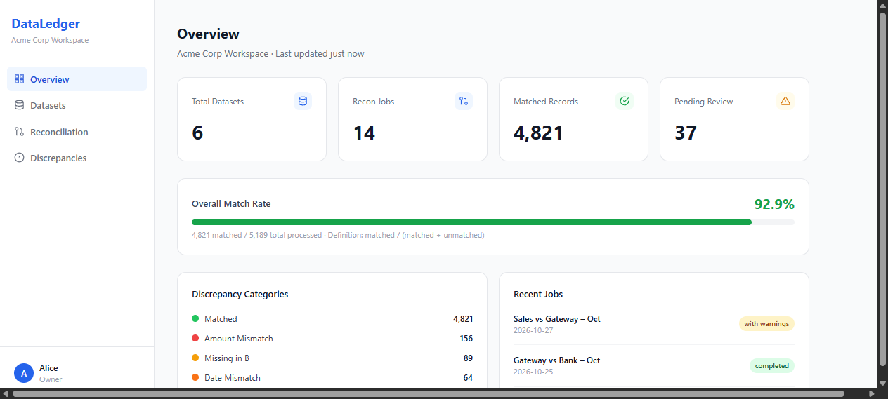
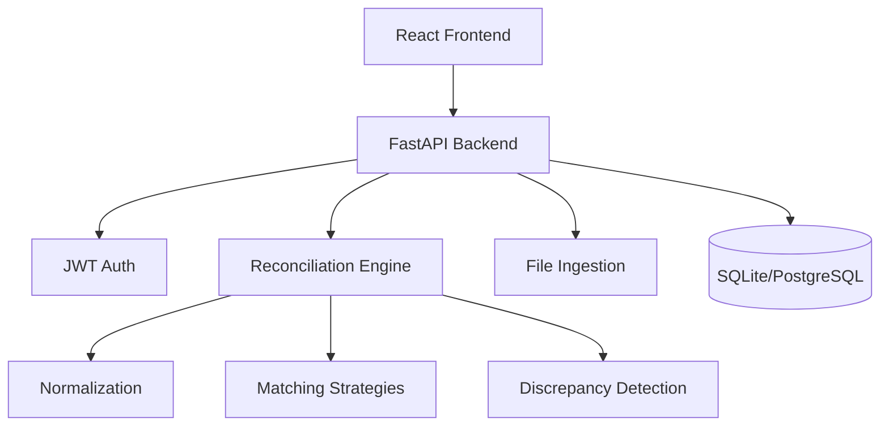

# DataLedger

**Open-Source Business Data Reconciliation Platform**

[](LICENSE)
[](https://python.org)
[](https://fastapi.tiangolo.com)
[](https://react.dev)

DataLedger is an open-source platform for automated business data reconciliation — compare datasets, detect discrepancies, and generate auditable reports.

<p align="center">
  
</p>

## Use Cases

- Match sales system transactions against payment gateway reports
- Compare payment gateway settlements with bank statements  
- Validate invoice data against customer payments
- Detect duplicate, missing, or mismatched transactions
- Find amount, date, or reference discrepancies between any two datasets

## Features

- **Data Import**: CSV, XLSX, JSON with schema detection, column mapping, validation
- **Reconciliation Engine**: Exact match, composite key, amount tolerance, date tolerance
- **Discrepancy Detection**: 9 categories — matched, missing, amount/date/reference mismatch, duplicate, ambiguous, invalid
- **Explainable Results**: Every match/mismatch includes a human-readable explanation
- **Review Workflow**: Accept, reject, resolve discrepancies with audit trail
- **Export**: CSV and JSON export with formula injection protection
- **Audit Logging**: Complete activity trail per workspace
- **Multi-tenant**: Workspace isolation — users can only see their own data
- **RBAC**: Owner, Admin, Analyst, Viewer roles with backend-enforced permissions

## Tech Stack

| Layer | Technology |
|-------|-----------|
| Frontend | React 19, TypeScript, Vite, Tailwind CSS, TanStack Query |
| Backend | Python 3.11+, FastAPI, SQLAlchemy 2.x, Alembic |
| Database | SQLite (dev) / PostgreSQL (production) |
| Auth | JWT (python-jose), bcrypt |
| Testing | pytest, pytest-asyncio, httpx |

## Quick Start

### Prerequisites
- Python 3.11+ 
- Node.js 18+
- Git

### Backend Setup

```bash
cd apps/api
python -m venv .venv
# Linux/Mac:
source .venv/bin/activate
# Windows:
.venv\Scripts\activate

pip install -r requirements.txt
cp ../../.env.example .env
# Edit .env if needed (default uses SQLite)

uvicorn app.main:app --reload --port 8000
```

API docs: http://localhost:8000/api/docs

### Frontend Setup

```bash
cd apps/web
npm install
# Create .env.local:
echo "VITE_API_URL=http://localhost:8000/api/v1" > .env.local
npm run dev
```

Frontend: http://localhost:5173

## Running Tests

```bash
cd apps/api
python -m pytest tests/ -v
# Unit tests (engine only, no DB):
python -m pytest tests/unit/ -v
# Integration tests (API + in-memory SQLite):
python -m pytest tests/integration/ -v
```

## Project Structure

```
dataledger/
├── apps/
│   ├── api/                    # FastAPI backend
│   │   ├── app/
│   │   │   ├── api/v1/         # Route handlers
│   │   │   ├── core/           # Config, database, security, deps
│   │   │   ├── models/         # SQLAlchemy ORM models
│   │   │   ├── schemas/        # Pydantic schemas
│   │   │   ├── services/       # Audit logging
│   │   │   ├── ingestion/      # File parser (CSV/XLSX/JSON)
│   │   │   └── reconciliation/ # Core matching engine
│   │   └── tests/
│   │       ├── unit/           # Engine unit tests (39 tests)
│   │       └── integration/    # API integration tests (11 tests)
│   └── web/                    # React frontend
│       └── src/
│           ├── app/            # App shell, AuthContext
│           ├── features/       # Auth, Dashboard, Datasets, Recon, Discrepancies
│           └── lib/            # API client
├── samples/                    # Sample CSV files for demo
│   ├── sample_sales.csv
│   └── sample_payments.csv
└── docs/                       # Architecture documentation
```

## Sample Data

Try with the included sample datasets in `samples/`:

- `sample_sales.csv` — Sales transactions (source A)
- `sample_payments.csv` — Payment gateway records (source B)

Contains: exact matches, amount mismatches, date mismatches, missing records, duplicates, and invalid records.

## Architecture



## API Endpoints

| Method | Path | Description |
|--------|------|-------------|
| POST | /api/v1/auth/register | Register user |
| POST | /api/v1/auth/login | Login |
| GET | /api/v1/workspaces | List workspaces |
| POST | /api/v1/workspaces/{id}/datasets | Create dataset |
| POST | /api/v1/workspaces/{id}/datasets/{id}/upload | Upload file |
| POST | /api/v1/workspaces/{id}/datasets/{id}/import | Import with mapping |
| POST | /api/v1/workspaces/{id}/reconciliation/jobs | Create job |
| POST | /api/v1/workspaces/{id}/reconciliation/jobs/{id}/run | Run job |
| GET | /api/v1/workspaces/{id}/reconciliation/jobs/{id}/results | Get results |
| GET | /api/v1/workspaces/{id}/discrepancies | List discrepancies |
| POST | /api/v1/workspaces/{id}/discrepancies/{id}/review | Review |
| GET | /api/v1/workspaces/{id}/reconciliation/jobs/{id}/export | Export CSV/JSON |
| GET | /api/v1/workspaces/{id}/dashboard | Dashboard metrics |

Full OpenAPI docs: `/api/docs`

## Security

- JWT tokens for authentication (never stored in plaintext)
- bcrypt password hashing
- Backend-enforced authorization (RBAC)
- Workspace isolation — IDOR prevention
- CSV formula injection protection on export
- File upload validation (type, size, path traversal)
- Parameterized queries via SQLAlchemy ORM

See [SECURITY.md](SECURITY.md) for security policy and known limitations.

## Roadmap

### Phase 1 — MVP ✅
- Authentication, workspace management
- Dataset import (CSV, XLSX, JSON)
- Schema detection and column mapping
- Reconciliation engine (exact, composite, amount tolerance, date tolerance)
- Discrepancy detection (9 categories)
- Review workflow and audit logging
- CSV/JSON export

### Phase 2 — Advanced (Planned)
- Fuzzy matching for text fields
- Scheduled reconciliation jobs
- XLSX export
- Multi-dataset reconciliation

### Phase 3 — Integrations (Planned)
- Database connectors (PostgreSQL, MySQL)
- REST API connectors
- S3-compatible object storage

### Phase 4 — Enterprise (Planned)
- SSO integration
- Advanced RBAC
- Retention policies
- Operational monitoring

## Contributing

See [CONTRIBUTING.md](CONTRIBUTING.md).

## License

MIT — see [LICENSE](LICENSE).
